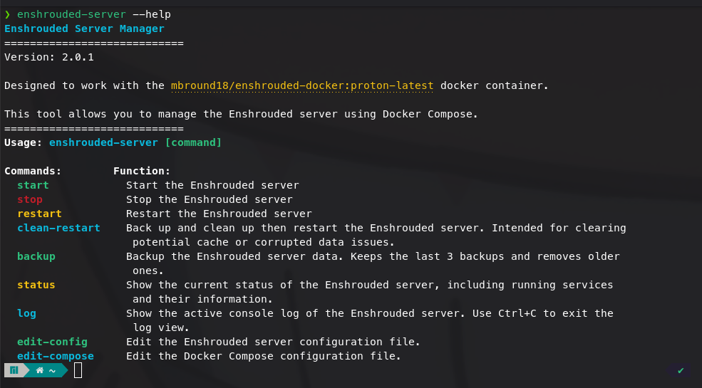

# enshrouded-server
Quick start enshrouded server using mbround18/enshrouded-docker:proton-latest with helpful wrapper script

# Getting Started
1. Install `docker`
2. Install `docker-compose`
3. Add your account to the docker group `sudo usermod -aG docker $USER` assuming you want to run as current user
4. Copy the `docker-host` directory to the folder you want to run our server from
5. Link the service script `ln -s /path/to/folder/docker-host/bin/enshrouded-server.sh ~/.local/bin/enshrouded-server`
6. Edit your compose ymlm file `enshrouded-server edit-compose`
 - set timezone `TZ=`
 - set name `NAME=`
 - set admin password `SET_GROUPADMIN_PASSWORD=`
 - set guest password `SET_GROUP_GUEST_PASSWORD=`
 - for first run, leave `SKIP_GAME_CONFIG_GEN=false` but change it to try if you want to customize the server config
7. Save the yml `ctrl+x`
8. Start the server `enshrouded-server start && enshrouded-server log` 